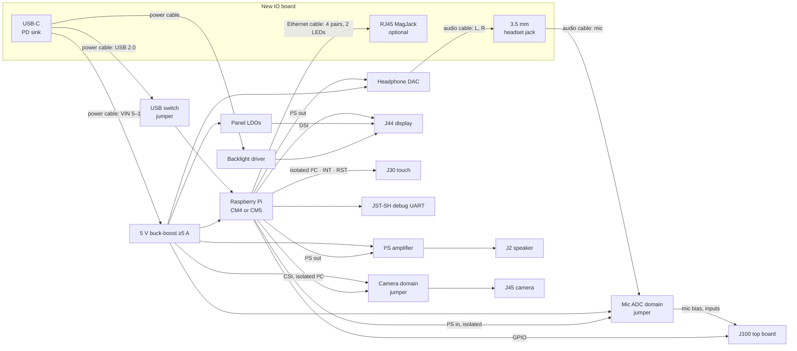

# CM4/CM5 carrier board: plan

A drop-in replacement for the Echo Show 5's mainboard (KC19-TI MLB V4.0) that carries a Raspberry Pi
Compute Module 4 **or** Compute Module 5 and plugs into the original display (J44), touch (J30), top board (J100), camera (J45)
and speaker (J2) ribbons. A new IO board replaces the Echo's, with USB-C for power and data plus a 3.5 mm
headset jack, and optionally an RJ45 Ethernet jack in a 3D-printed back plate. Background, measurements and the decision to use a CM4: [ECHO-SHOW-5.md](ECHO-SHOW-5.md).

Status: **planning.** Nothing is drawn yet. Items marked *draft* change once the Echo's connectors are
mapped with the [breakout board](echo-breakout/README.md).

Sources, cited in brackets:
- [DS] *Raspberry Pi Compute Module 4 Datasheet*,
  [datasheets.raspberrypi.com/cm4/cm4-datasheet.pdf](https://datasheets.raspberrypi.com/cm4/cm4-datasheet.pdf), with section numbers.
- [DS5] *Raspberry Pi Compute Module 5 Datasheet*,
  [datasheets.raspberrypi.com/cm5/cm5-datasheet.pdf](https://datasheets.raspberrypi.com/cm5/cm5-datasheet.pdf), with section numbers
  (Appendix B lists the differences from the CM4).
- [DBG] *Raspberry Pi 3-pin Debug Connector Specification* (RP-003139-SP),
  [datasheets.raspberrypi.com/debug/debug-connector-specification.pdf](https://datasheets.raspberrypi.com/debug/debug-connector-specification.pdf).

## Goals

1. **Fits the case:** the front shell, screen and frame unchanged; the rear plastic plate either the
   original (two openings) or a 3D-printed replacement (see "IO board and back plate"). The carrier keeps
   the mainboard's outline (108 × 60 mm), its six M2 screw positions, two alignment holes and grounding
   pads, and each ribbon socket where the original was. These already exist
   in [`echo-breakout/gen_board.py`](echo-breakout/gen_board.py); the carrier reuses them as its single
   source of geometry.
2. **An open board for different owners.** Every optional feature (Wi-Fi, Bluetooth, USB data,
   microphones, camera) is fitted and works, and each one can be **physically switched off by removing a jumper**: its
   power removed or its signal disconnected in hardware, not a setting software could undo. With a feature
   off, or its ribbon unplugged, everything else works normally.
3. **Easy to work on:** the debug UART on a populated standard connector, test pads on every rail and
   control line, USB-C power and data, and a headphone/headset jack.
4. **Takes a CM4 or a CM5** with no board change, so a builder can trade heat for speed (see "CM4 or CM5").
5. **Generated by script**, like the breakout, so a pinout correction is a re-run rather than a re-draw.

## Constraints

| Item | Value | Source |
|---|---|---|
| Outline | 108 × 60 mm, 1.0 mm thick (the ribbons wrap the edge; thicker uses up ribbon length) | ECHO-SHOW-5.md, breakout |
| Layers | 4 (the breakout already needed 4 for the 0.3 mm fan-out), impedance-controlled stackup | breakout |
| Height | Mainboard parts reach **3.1 mm** over the shielded processors and **8.8 mm** at C9211 by the speaker socket. Clearance from board to rear case per region: **not measured yet** | ECHO-SHOW-5.md |
| Module size | Both 55 × 40 mm, 4 × M2.5 holes inset 3.5 mm. CM4 PCB 1.2 mm, CM5 1.24 mm | [DS 3.1], [DS5 4.1.1] |
| Module height, 1.5 mm stack | CM4 **5.078 mm**, CM5 **4.94 mm** above the carrier, nothing under the module | [DS 3.1], [DS5 4.1.1] |
| Carrier connectors | CM4 datasheet: Hirose DF40C-100DS-0.4V (1.5 mm) or DF40HC(3.0)-100DS-0.4V (3.0 mm). CM5 datasheet: Amphenol 10164227-1001A1RLF (1.5 mm) or 10164227-1004A1RLF (4.0 mm), "tested to higher currents" for the CM5 | [DS 3.1], [DS5 4.1.1, B.1.2] |
| Supply | Single +5 V, 4.75–5.25 V, rising monotonically and staying above 4.75 V. CM4 typical 0.4 A idle, 1.4 A under load. CM5 typical 0.4 A idle, 0.9 A under load, and the supply should allow **up to 2.5 A** | [DS 5.1, 5.3], [DS5 3.1, 3.3, B.3] |
| Module outputs | 3.3 V and 1.8 V, 600 mA each, on both | [DS 4, 5.1], [DS5 3.4] |
| Pins before power | No pin may have power applied before +5 V is up (both) | [DS 5.1], [DS5 3.1] |
| Temperature | Both throttle to keep the SoC under 85 °C; rated −20 to +85 °C, best Wi-Fi up to 75 °C | [DS 3.2], [DS5 4.4] |

**The height is the first gate.** The module adds at least 5.1 mm above the carrier, and the old board only
reached 3.1 mm over most of its area. Before any layout: measure the clearance from the mainboard's
component side to the rear case across the board (modelling clay pressed in by closing the case, or
a depth gauge), and find a 55 × 40 mm region with at least 5.5 mm plus the thermal stack on top. The
jumper block and connectors need the same check.

## CM4 or CM5

The CM5 is "mostly compatible" with CM4 carriers [DS5 1.2]. Its differences [DS5 B.1] decide several choices
on this board:

| Difference on the CM5 | Consequence here |
|---|---|
| The CM4's **DSI0** pins (157–171) and **CAM0** pins (128–142) carry **USB 3.0** instead | The display uses **DSI1** and the camera **CAM1**. On the CM5 those pins are the 4-lane MIPI1 and MIPI0 ports, each usable for a display or a camera [DS5 2.5.2]. DSI0 and CAM0 stay unconnected |
| Camera I²C: SDA0/SCL0 (pins 80/82) belong to the CAM1 port on the CM4 [DS 2.9] and to MIPI0, at the same pins, on the CM5 [DS5 2.6.1] | The camera on CAM1 with I²C on pins 80/82 works on both |
| Pin 92: RUN_PG (reset) on the CM4, **PWR_Button** on the CM5 (short press: wake or shut down; long press: force off; pulled up to 5 V through 10 kΩ) [DS5 B.1.1, 4.2] | One button to ground through 220 Ω, labelled RESET/POWER. On a CM4 it resets; on a CM5 it's a proper power button. Nothing else drives the pin |
| Pin 76: "reserved, do not connect" on the CM4, **VBAT** for the CM5's real-time clock (2.5–3.5 V) [DS5 2.12.2] | A coin-cell holder behind a **solder jumper, open by default**, marked "CM5 only". A real-time clock means the right time (and so working TLS) before the network is up |
| Pins 94/96: CM4 ADC inputs, **CC1/CC2** on the CM5 (its own USB-C 5 V/5 A negotiation) | Not connected. The IO board's PD controller owns the USB-C CC lines; the module never sees them |
| Pins 16, 19, 100, 104, 106, 111: fan, PCIe, VBUS and camera signals on the CM5 [DS5 B.1.1] | Not connected (none are used on the CM4 either) |
| Up to **2.5 A at 5 V** [DS5 B.3] | The 5 A, 5 V rail already covers it |
| BT_nDisable may only be driven low on the CM5 [DS5 2.1.2] | The BT jumper's MOSFET only ever pulls it low: fine on both |
| The CM4's extra ESD protection on SDA/SCL (and HDMI) is gone on the CM5 [DS5 B.1.2] | ESD protection on every I²C line that leaves the board (touch, camera, mic) |
| Connectors changed brand, rated for higher current [DS5 B.1.2] | Use the CM5 datasheet's Amphenol carrier connectors, after confirming from Amphenol's drawing that they also mate with the CM4 |
| A debug UART of its own on the module (a JST SH footprint and test points on the module) [DS5 2.8] | The carrier's JST SH on GPIO14/15 works on both, as UART0. On a CM5, early boot messages may only appear on the module's own debug UART |
| All GPIO functions used here exist on both: I²C1 on GPIO2/3, PWM0 on GPIO12/13, UART0 on GPIO14/15, I²S on GPIO18–21 [DS 2.5.1], [DS5 2.9.1] | One GPIO map for both |

**Heat decides which to fit, not the board.** Whatever the module, the sealed case can only shed roughly
8–12 W in total at a comfortable surface temperature (estimate; to measure). A CM5 finishes bursts faster
and renders the dashboard more smoothly; for sustained loads its clock speed is capped in software (the
CM5 datasheet suggests lowering the clock to cut peak power [DS5 B.3]). The bench stage measures both in
the closed case.

## Block diagram

## Power

### IO board and back plate

The Echo's IO board (KC19 IO BD) brings 12 V from a barrel jack and USB 2.0 from a micro-USB port over one
31-pin ribbon (J46). Both are replaced. The rear plastic half of the case is a separate part, so it can be
3D-printed with whatever openings the build needs. Two back-plate options:

| | **A: original back plate** | **B: printed back plate** |
|---|---|---|
| USB-C | In the micro-USB slot, filed out slightly (USB-C is about 8.9 × 3.2 mm) | Its own opening |
| 3.5 mm headset jack | In the barrel-jack opening (a larger-nosed jack or a printed bushing to sit flush) | Its own opening, **if there's room** |
| RJ45 Ethernet | No | Its own opening (about 16 × 14 mm, or 16 × 10 mm for a low-profile jack) |
| Vents | No | Yes (see "Heat") |
| Look | Unchanged apart from the filed slot | Printed rear, same shape |

Whether B fits all three ports depends on the space behind the rear wall: together they need roughly
40 × 25 mm of IO board, depending on layout. If they don't fit, build B as **USB-C + RJ45** or **USB-C +
3.5 mm jack**. One IO board with footprints for all three, populated to suit, is the first thing to try;
two board variants if the layouts can't share one outline. The IO board no longer has to copy the Echo's
outline, only fit the space and the plate's mounting points.

| Item | Plan |
|---|---|
| Power | USB-C with a **PD sink controller that needs no firmware** (configured by resistors or its own NVM). Request **15 V at 3 A (45 W)**, accepting 12 V, 9 V, or 5 V when the source advertises 3 A |
| Why not more | 100 W needs 20 V at 5 A and an e-marked 5 A cable, for a device that needs about 11–17 W. 45 W is ample. Capping the request at 15 V also keeps VIN below the backlight's string voltage (see "Backlight") |
| USB data | USB-C D+/D− to the carrier's USB switch (see "Jumper block"): one cable for power and service |
| Barrel jack | **Removed**; power is USB-C only |
| 3.5 mm jack | 4-pole headset jack (CTIA: tip L, ring 1 R, ring 2 ground, sleeve mic) with a detect switch |
| RJ45 | A 1:1 **MagJack** (magnetics inside), as both datasheets specify [DS 2.2], [DS5 2.2.1], with ESD protection. Its two LEDs from Ethernet_nLED3 (pin 15) and Ethernet_nLED2 (pin 17), which mean the same on both modules; **not** nLED1 (pin 19), which is the fan output on a CM5 [DS5 B.1.1] |
| Strain relief | The IO board screwed to the back plate at both ends; an RJ45 takes real force when a cable is plugged in, so the printed plate needs solid bosses there |
| Alternative jack spot | The Echo's IO board has an unpopulated **J1** footprint, almost certainly a 3.5 mm jack, with a guide mark on the original plate where its hole would be |

**Cables instead of J46**, so power, USB, Ethernet and analog audio never share one:

| Cable | Carries | Notes |
|---|---|---|
| **Power/USB** | VIN, ground, USB D+/D−, PD power-good | Contacts sized for 3 A with at least 50 % margin per contact (several VIN and ground contacts in parallel; a wider pitch than the Echo's 0.3 mm). D+/D− side by side with ground either side, kept short |
| **Audio** | Headphone L, R and their return, mic and mic return, jack detect | Ground contacts between channels; routed away from the power/USB cable |
| **Ethernet** (option B) | Four differential pairs, two LED lines | Each pair on adjacent contacts with ground between pairs, as short as possible. Pairs must be 100 Ω with each pair matched to 0.15 mm on both boards [DS 2.2], [DS5 2.2.1]; a flat cable isn't impedance-controlled, so **check that gigabit links cleanly** on the bench (100 Mbit/s is far more tolerant). A micro-coax or twisted-pair harness is the fallback |

The carrier's sockets can sit anywhere along the path the J46 ribbon took through the case. Unused
cables (audio or Ethernet) simply aren't fitted.

### Printed back plate

- **Material:** PETG, ASA or PC, ideally a flame-retardant grade. Not PLA: it softens around 55–60 °C, too
  close to the temperature next to the SoC and speaker. The original is probably flame-rated PC/ABS.
- **Fit:** copy the original's clips or screw bosses and any acoustic seal around the speaker. Scan or
  measure the original plate before modelling.
- **Antenna:** plastic is RF-transparent. A recess at the top edge can hold the adhesive Wi-Fi antenna.
- **Service hatch (optional):** a small removable cover over the jumper block and debug connector, so
  they're reachable without opening the case.
- **Vents:** see "Heat".
- Lives in this folder as a parametric model (OpenSCAD or similar), so openings can be added or moved per build.

### Tree

| Rail | From | Feeds | Notes |
|---|---|---|---|
| VIN 5–15 V | Power/USB cable | 5 V regulator, backlight driver | Polyfuse, reverse-polarity and TVS protection on the carrier too |
| 5 V | **Buck-boost, 5 A**, input 4.5–20 V | CM4, panel LDOs, amplifier, headphone DAC, mic and camera domains | Buck-boost so a plain 5 V USB-C supply also works. Rises monotonically and stays above 4.75 V under load steps [DS 5.1]. 5 A leaves headroom, and doesn't rule out a CM5 later (not a goal; heat would decide that) |
| Module 3.3 V | CM4_3.3V / CM5_3.3V | GPIO_VREF (if 3.3 V), always-on logic, isolators' module-side supply | Within 600 mA. Off whenever the module is off |
| Module 1.8 V | CM4_1.8V / CM5_1.8V | GPIO_VREF (if 1.8 V) only | On the CM4 its load must fall to zero on sudden power loss [DS 4], so nothing else uses it |
| Panel 2.8 V, 1.8 V | Two LDOs from 5 V, each with an enable | J44 | Enables pulled low until Linux sequences them: 2.8 V first, then 1.8 V; reverse at power-off |
| Touch | Load switch from 3.3 V | J30 | See "Touch" |
| Headphone | LDO from 5 V | Headphone DAC | Always available; muted by GPIO until Linux starts |
| Mic | Load switch from 5 V, then LDO(s) | ADC and mic bias (top-board mics and the jack's mic) | Enable = jumper **and** GPIO |
| Camera | Load switch from 5 V, then the sensor's rails (typically 2.8 V, 1.8 V, 1.2 V *(to confirm)*) | J45 | Enable = jumper **and** GPIO |
| LED+ | Boost LED driver from VIN | Backlight strings | Enable and PWM from GPIOs, off by default |

### Budget (to confirm on the bench)

| Load | Estimate |
|---|---|
| CM4 under load (1.4 A at 5 V typical; peaks higher) | 7 W |
| *or* CM5 at its 2.5 A design peak | *12.5 W* |
| Speaker amplifier (about 1–2 W into 8 Ω at 5 V) | 2 W peak |
| Headphone DAC | under 0.2 W |
| Backlight (if 2 strings × 20 mA at about 18 V) | 0.8 W |
| Panel, touch, microphones, camera | about 0.5 W |
| Conversion losses (about 90 % efficient) | 1 W |
| **Total** | **about 11 W (CM4), up to about 17 W peak (CM5)** |

A 45 W USB-C supply covers either. A plain 5 V, 3 A source (15 W) suits a CM4, or a CM5 with its clock
capped. The case, not the supply, limits sustained power (see "CM4 or CM5"). The bench check: CPU stress
test, full backlight, speaker playing, camera streaming.

### Power loss
A sudden input drop leaves no time for an orderly shutdown. Software handles it instead: a read-only root
with overlayfs, which the datasheet also suggests [DS 5.2]. A VIN divider into the GPIO expander gives a
power-fail flag, so the launcher can stop writing logs.

## Isolation rules for switchable domains

Touch, microphones and camera each sit in their own power domain that can be switched off: by a jumper,
by software, or by unplugging its ribbon. The same rules apply to each, so that "off" means off, and
nothing else notices:

1. **Power through a load switch** with quick output discharge. For jumper-controlled domains the enable is
   *jumper AND GPIO*: the jumper in series with the GPIO's enable line, and a pull-down on the switch side.
   Software can turn a domain off, but can't turn it on with the jumper removed.
2. **Every signal crossing into a domain goes through an isolating buffer or translator** powered from both
   sides, with partial-power-down (Ioff) protection, and disabled while the domain is off. Nothing on the
   module side can back-power an off domain, and an off domain can't load a shared bus.
3. **Pull-ups for a domain's signals sit on the domain side**, so an off or unplugged domain reads as
   absent, not stuck.
4. **A power-good readback** for each domain (through the GPIO expander), so Linux and the UI see the real
   hardware state.
5. **Nothing in the always-on part of the board depends on an optional domain.** Device tree entries for
   optional parts tolerate a failed probe.

## Jumper block

One clearly labelled block near the board edge. The rule throughout: **fitted = enabled, removed =
physically off.**

| Jumper | Fitted | Removed | How |
|---|---|---|---|
| **WIFI** | Wi-Fi available | Wi-Fi radio held off | As BT, on WL_nDisable [DS 2.1.1], [DS5 2.1.1]. Removing it leaves **no network** unless Ethernet is fitted: for wired-only builds |
| **BT** | Bluetooth available | Bluetooth radio held off | A small MOSFET pulls BT_nDisable low unless the jumper grounds its gate [DS 2.1.2] |
| **USB** | USB data connected to the module | D+/D− disconnected | A USB 2.0 high-speed analog switch; the jumper drives its enable. No jumper in the 90 Ω pair itself |
| **MIC** | Microphone domain can be powered | ADC and mic bias unpowered: the built-in microphones **and** a headset's mic are dead. Headphone output keeps working | Rule 1 above |
| **CAM** | Camera domain can be powered | Camera unpowered and its I²C isolated | Rule 1 above |
| **EEPROM** | Bootloader EEPROM writable | Write-protected | Removed holds EEPROM_nWP low; must be set before power-up [DS 2.18, 5.1] |
| **RPIBOOT** | USB boot (`rpiboot`) on next power-up | Normal boot from eMMC | Fitted holds nRPIBOOT low; must be low within 2 ms of +5 V rising [DS 2.15, 5.1] |

Every jumper's state is also readable through the GPIO expander.

Which jumpers ship fitted is the builder's choice. One suggestion: WIFI fitted (removed on a wired-only
build); BT, MIC and CAM removed; USB, EEPROM and RPIBOOT removed except while servicing.

Form factor: standard 2.54 mm shunts stand about 6 mm or more above the board. That may not fit the height
map, so consider **1.27 mm headers with micro shunts**, or a low-profile SMD DIP switch as a fallback. Decide
once the clearance map exists.

## Module signals

### Fixed choices

| Pin | Use |
|---|---|
| BT_nDisable | BT jumper (above); only ever pulled low, as the CM5 requires [DS5 2.1.2] |
| WL_nDisable | WIFI jumper (above); only ever pulled low |
| EEPROM_nWP | EEPROM jumper (above) |
| nRPIBOOT | RPIBOOT jumper (above), plus a test pad |
| USB_P / USB_N | Through the USB switch and the power/USB cable to the USB-C port. 90 Ω pair on the carrier, matched to 0.15 mm [DS 2.4] |
| USB_OTG_ID | Floating, so the CM4 is a USB device: `rpiboot` and a USB gadget console work [DS 4] |
| USB VBUS | Is VIN itself now: no separate sense; the PD controller's power-good goes to the expander |
| GLOBAL_EN / PMIC_EN (pin 99) | Floating (pulled up on the module), test pad [DS 2.13], [DS5 2.12.2] |
| RUN_PG / PWR_Button (pin 92) | RESET/POWER button to ground through 220 Ω (see "CM4 or CM5") |
| Pin 76 (CM5 VBAT) | Coin cell through a solder jumper, open by default, CM5 only. Two safeguards for a CM4: the jumper stays open **and** the holder stays empty. The CM5's charger stays off in software unless a rechargeable cell is fitted: never charge a CR2032. The only setting that differs between modules |
| Pins 94, 96 (CM5 CC1/CC2) | Not connected |
| LED_nACT, PI_LED_nPWR | Two small LEDs on the board, buffered: boot error codes during bring-up [DS 2.16, 2.17] |
| GPIO_VREF | 3.3 V or 1.8 V, decided after J30 and J44 are measured (below) [DS 2.5] |
| DSI1 | Display, 2 lanes (see "Display") |
| CAM1 | Camera (see "Camera") |
| DSI0, CAM0 | **Not connected**: USB 3.0 on a CM5 [DS5 B.1.2] |
| Ethernet pairs (pins 3–12), nLED3 (15), nLED2 (17) | To the Ethernet cable socket, for option B; nothing fitted otherwise. Same pins on both modules |
| Ethernet nLED1 (19), SYNC_IN (16) | Not connected: the CM5's fan PWM and tacho |
| PCIe, HDMI, SD, fan | Not connected |

### GPIO_VREF: 3.3 V or 1.8 V
- **3.3 V (default):** the usual choice, and what the debug connector spec prefers [DBG]. The panel reset
  (very likely 1.8 V) and a 1.8 V touch bus are already behind domain-powered translators, so they cost
  nothing extra.
- **1.8 V:** fewer translators, but every always-on part (amplifier, expander, buttons) must accept 1.8 V.

Rev A can carry both options as 0 Ω links.

### Draft GPIO map *(draft)*

Slow signals go through an **I²C GPIO expander** on the always-on bus, so the module's 28 GPIOs are kept for
anything that needs interrupts, timing or a peripheral function.

| GPIO | Function | Use |
|---|---|---|
| 2, 3 | SDA1/SCL1 (1.8 kΩ pull-ups on the module [DS 4]) | Always-on I²C: expander; branches through isolators to touch and to the mic ADC |
| 4 | Input | Touch INT (through its isolator) |
| 5 | Output | Touch RST (through its isolator) |
| 6 | Output | Panel reset (through a translator powered by the panel's 1.8 V) |
| 7, 8, 9 | Inputs | J100 buttons SW1–SW3 (`gpio-keys`) |
| 10 | Input | J100 privacy cover switch |
| 11 | Input | Expander interrupt |
| 12 | PWM0_0 | Backlight PWM |
| 13 | Input | Jack detect. If a second backlight PWM turns out to be needed, it takes GPIO13 (PWM0_1) and jack detect moves to GPIO0 or the expander |
| 14, 15 | TXD0/RXD0 | Debug UART (see "Debug connectors") |
| 16, 17 | Outputs, pulled low | Panel 2.8 V and 1.8 V LDO enables |
| 18, 19 | PCM_CLK, PCM_FS | I²S clocks: amplifier, headphone DAC, and the mic ADC through its isolator |
| 20 | PCM_DIN | I²S data **in** from the mic ADC (through its isolator) |
| 21 | PCM_DOUT | I²S data out to the amplifier and the headphone DAC |
| 22 | Output, pulled low | Backlight driver enable |
| 23 | Output, pulled low | Amplifier enable |
| 24 | Output, pulled low | Mic domain enable (AND MIC jumper) |
| 25 | Output, pulled low | Camera domain enable (AND CAM jumper) |
| 26 | Output | Camera reset/power-down (through its isolator) |
| 27 | Output, pulled low | Touch domain enable |
| 0, 1 | ID_SD/ID_SC | Spare. Firmware may claim them: with DSI0/CSI0 on a CM4 [DS 2.10], with MIPI1 (our display port) on a CM5 [DS5 2.6.2]; set `force_eeprom_read=0` before reusing them |
| — | SDA0/SCL0 on pins 82/80 (CM4 GPIO44/45, CM5 RP1 GPIO38/39; 1.8 kΩ pull-ups on the module) | Camera I²C, through its isolator: the bus paired with CAM1 / MIPI0 on both [DS 2.9], [DS5 2.6.1] |

On the expander: LED1, LED2, headphone DAC mute, PD power-good, VIN power-fail, power-good for touch, mic and camera, and
readback of every jumper.

## Display (J44)

- **Port: DSI1**, using 2 of its 4 lanes. The panel needs about 424 Mbit/s per lane; the CM4 manages up to
  1 Gbit/s per lane [DS 2.8]. DSI0 is out: those pins are USB 3.0 on a CM5. On a CM5, DSI1's pins are MIPI1.
- **Driver:** the CM4 datasheet only supports DSI displays the official firmware knows [DS 2.8]; the CM5
  datasheet adds displays supported by the mainline Linux kernel [DS5 2.5.2]. This build relies on the Linux
  KMS driver (`panel-sitronix-st7701`) on both. The bench stage proves it before the carrier is ordered.
- **Routing:** 100 Ω differential, each pair matched to 0.15 mm, short, on one layer over solid ground.
  Copy the Echo's ESD protection with a low-capacitance part rated for MIPI.
- **Panel ID:** read the display ID over DSI. Neither module has an ADC; an I²C ADC on the J44 ID pin is an
  optional extra.
- **Reset:** high, 10 ms low, high, then 120 ms before init, at the panel's I/O level.

## Backlight

The Echo used a boost converter (L20, 10 µH; D18; R335/R336, probably 10 Ω current-sense resistors on two
strings). To choose once measured:

| Requirement | Value |
|---|---|
| Input | VIN, 5–15 V (the PD request is capped at 15 V) |
| Output | LED+ voltage of the strings (expected 15–20 V *(unconfirmed)*). If the strings measure below 15 V, a boost driver can't regulate at 15 V input: then use a buck-boost LED driver, or cap the PD request at 12 V |
| Channels | 1 or 2 strings, matching the J44 LED− pins |
| Current | About 20 mA per string *(unconfirmed)* |
| Dimming | PWM from GPIO12, plus an enable, off by default |
| Protection | Open-LED overvoltage protection (the ribbon can be unplugged while powered) |

## Touch (J30)

A proper switchable domain, so a stuck GT911 can be power-cycled and an unplugged ribbon causes no harm:

- **Power:** load switch from 3.3 V (or a 2.8 V LDO if J30 measures that way), enabled by GPIO27, with
  output discharge, so a power-cycle is a clean reset.
- **I²C:** a branch of the always-on I²C1 bus through an **isolating translator with an enable** (passive
  FET translator class), powered from the module side and the touch rail. Touch-side pull-ups go to the touch
  rail. With the touch off, the branch is cut and the module's 1.8 kΩ pull-ups can't back-power the GT911.
- **INT and RST:** through a second isolating translator in the same domain. A pull-down on the touch side
  of INT holds it low through reset, fixing the address at **0x5d** (the GT911 picks 0x5d or 0x14 from INT's
  level at reset) even if the driver can't drive INT.
- Series resistors and ESD protection on the touch side, as on the breakout.
- **Never write the GT911's config block** (see ECHO-SHOW-5.md).

## Audio

### Speaker
An I²S class-D amplifier (MAX98357A-class, from 5 V) into the original speaker through J2, enabled by
GPIO23 so it stays silent until Linux starts.

### Headphone and line out
- **An I²S DAC with a headphone driver**, separate from the mic ADC, on the same I²S data as the speaker
  amplifier. A ground-centred output (no DC-blocking capacitors) and a mute pin held until Linux starts, so
  there's no pop at power-up.
- **Jack detect** (the jack's switch, to GPIO13): plugging in headphones turns the speaker amplifier off in
  software. A hardware option: the detect switch also gates the amplifier's enable.
- Analog lines leave over the **audio cable** with grounds between them; ESD protection at the jack.
- **Why a separate DAC rather than one codec:** a codec that plays and records (TLV320AIC3104-class) would save
  a part, but then removing the MIC jumper couldn't unpower it without losing headphone output. Separate parts
  keep the jumper's meaning simple: no microphone works, everything else does.

### Microphones
For owners who want voice control (Home Assistant Assist, for example), the Echo's two microphones can work
again, behind the MIC jumper:

- **Two sources:** the top board's two microphones, and a headset's mic on the 3.5 mm jack (over the audio
  cable). Both go to the same ADC, so the MIC jumper covers both.
- **The microphones are analog MEMS parts on the top board** (MK1, MK2), reached through J100. They need a
  bias voltage and an ADC, which the old mainboard provided with a TI TLV320ADC3101 (ECHO-SHOW-5.md,
  "Microphones").
- **ADC:** the same TLV320ADC3101 is the low-risk choice: it worked with these exact microphones and sensors,
  has differential inputs and built-in mic bias. Check its Linux driver support (`tlv320adc3xxx`) before
  committing; a different I²S ADC with mic bias is the fallback.
- **Its domain:** load switch and LDO(s), enabled by GPIO24 **and** the MIC jumper. The ADC makes the mic bias
  itself, so with the domain off the microphones have no bias and no ADC: dead in hardware.
- **Isolation:** its I²C branch, and the I²S clocks into it and data out of it, go through domain-powered
  isolating buffers (rule 2). With the domain off, GPIO20 sees a pull-down, not a floating line.
- **Privacy indicator in hardware:** drive one of the top board's LEDs from the mic domain's state directly
  (lit while the domain is **off**, or while it's on, to taste), not from a GPIO, so software can't show a
  false state. LED colours on the top board are still *(unconfirmed)*.
- **Optional: the mute button in hardware.** A small latch toggled by the top board's mute button could gate
  the mic domain too, like the original Echo's mute. Decide after J100 is mapped.

## Camera (J45)

Behind the CAM jumper, for owners who want it (video calls, Home Assistant camera, presence):

- **First, identify the sensor.** The dumps only name it `camera_main` (I²C 0x2e on the Echo's bus 0) and
  `camera_sub` (0x21). Read the module's markings, and its chip-ID registers through the breakout's EXT header.
  **Whether a Linux driver exists for the sensor decides whether the camera can be used at all.** The
  modules' firmware and libcamera support only a short list of sensors out of the box [DS 2.7], [DS5 2.5.2].
- **J45:** 25 pins; its socket and position aren't on the breakout yet. Add them to the geometry, and map
  the pins: CSI lanes, power rails, I²C, clock, reset/power-down.
- **CSI: CAM1** (4 lanes on the CM4 [DS 2.7]; MIPI0 on a CM5 [DS5 2.5.2]), using as many lanes as the
  sensor has. 100 Ω pairs. CAM0 is out: those pins are USB 3.0 on a CM5.
- **Domain:** load switch and the sensor's rails, enabled by GPIO25 **and** the CAM jumper. A clock oscillator
  inside the domain (so no clock runs into an unpowered sensor), reset/power-down through an isolator, and
  I²C (SDA0/SCL0, pins 80/82) through an isolating translator.
- **Unplugged or jumpered off:** the CSI pairs are simply open, the I²C branch reads empty, and the driver's
  probe fails without affecting anything else.
- The privacy cover's detector (SW4 on the top board) stays a GPIO input, and can also gate the camera domain
  in software.

## Top board (J100)

Buttons SW1–SW3 and the privacy switch to GPIOs; LED1/LED2 through transistors from the expander (and one
from the mic domain, above); microphone pins to the mic ADC. The light and proximity sensor (STK3x1x,
ECHO-SHOW-5.md) may be on this board too: if J100 carries it, put it on the always-on I²C for automatic
night dimming. Map the pins first with the breakout.

## Debug connectors

- **Module UART0 (GPIO14/15)** on a populated **3-pin JST SH, 1.0 mm** (top-entry BM03B-SRSS-TB or side-entry
  SM03B-SRSS-TB), Raspberry Pi's standard debug connector [DBG]:
  - pin 1 RX (into the module), pin 2 GND, pin 3 TX (out of the module), as seen from the target [DBG];
  - 100 Ω series resistors close to the target's pins [DBG];
  - the spec requires target pins that survive 3.3 V while unpowered ("failsafe") [DBG]. The module's pins
    may not have power applied before +5 V [DS 5.1], [DS5 3.1], so add a small buffer with Ioff between the
    connector and GPIO14/15.
- Whether Linux runs a login console on it is a software setting, documented with the image.
- **CM5:** the module also has its own debug UART (a JST SH footprint and test points on the module itself)
  [DS5 2.8]. Early boot messages may only appear there; with a 1.5 mm stack the module's underside test
  points can't be reached, so fit its connector if they're needed.
- **A second MCU, if one is ever added** (for example an RP2040 for soft power or the mute latch): its SWD on
  a second JST SH using the spec's serial-debug pinout (pin 1 SC, pin 2 GND, pin 3 SD) [DBG]. Rev A has no
  second MCU: everything above is done with plain logic, so there's no second firmware to maintain.

## Wi-Fi antenna

The Echo's own Wi-Fi antennas were printed on the mainboard's edge. The module's PCB antenna would sit over
the metal display frame, so use the **module's U.FL connector** (`dtparam=ant2` on the CM4 [DS 2.1]; the
CM5's wireless variant has the same antenna switch [DS5 1.3]) and an antenna at the top edge, where the
Echo's were:

1. **Rev A: an adhesive flexible dual-band antenna** (2.4 and 5 GHz) stuck inside the case's top edge, its
   U.FL cable straight to the module. No RF design on the carrier.
2. **Possible later: a PCB antenna on the carrier's edge** in the Echo's antenna position, fed from a U.FL
   jack on the carrier. It needs matching and tuning with a VNA. Keep that area free of copper on rev A so
   the option stays open.

Raspberry Pi certifies only its own antenna kit with the CM4 [DS 2.1] (check the CM5's terms the same way); another antenna is untested for
compliance. Measure the position of the Echo's antenna area from the mainboard photos and add it to the
geometry as a keep-out.

## Heat

Both modules have less passive heat sinking than the matching Raspberry Pi board [DS 3.2], [DS5 4.4], and
this is a sealed case with no fan. The plan: a thermal pad from the SoC (BCM2711 on the CM4, BCM2712 on the
CM5) to a copper spreader, connected to the **speaker module's copper plate**. If that isn't enough,
replace the plate with a thicker one.

To check:
- What the plate touches (case, speaker chamber, frame), and so where the heat goes in the end.
- Speaker magnet and chamber temperature: heat must not soften adhesives or detune the speaker.
- The whole stack (pad, spreader, plate) within the height map; a compliant pad takes up the tolerances.
- Steady-state temperature with the dashboard and radar running, at room temperature, in the closed case,
  for a CM4 and for a CM5 (with and without a clock cap).
- The case's own limit: the plate moves heat out of the SoC and buffers bursts for minutes, but in the end
  every watt leaves through the case surface (see "CM4 or CM5").

**Vents (printed back plate):** low intake slots and high exhaust slots let warm air rise out of the case by
itself, which raises that limit considerably; the most useful single change for a CM5. Keep them away from
the speaker's back volume so they don't change its sound, and small enough to keep fingers and debris out.
Measure the closed-case temperature with the original plate and with the vented one.

## Mechanical

- **Proposed module region:** the right-hand side of the board (about x 47–102, y 12–52 in the breakout's
  coordinates). It clears J44, J30 and J45 on the left and J100 and the IO board cables on the top edge, keeps every Echo
  screw out from under the module, and sits where the mainboard was tallest (the 8.8 mm part by the
  speaker socket). Confirm against the clearance map and the CM4 and CM5 STEP models.
- **Stack height:** 1.5 mm, unless something must fit under the module. Design for the taller of the two
  (the CM4, 5.078 mm).
- **Module mounting:** four M2.5 standoffs or press-in nuts at the module's holes, in addition to the six Echo
  screw positions.
- **Sockets:** J44, J30, J100 and J2 as on the breakout; **J45 added** at the mainboard's position; the
  **power/USB, audio and Ethernet cable sockets** in place of J46.
- **IO board:** for option A, the KC19 IO board's outline and mounting, USB-C lined up with the (filed)
  micro-USB slot and the 3.5 mm jack with the barrel-jack opening. For option B, whatever outline fits the
  space behind the rear wall, mounted to the printed plate.
- **Back plate:** original, or printed with openings to match the IO board (see "IO board and back plate").
- **Jumper block and debug connector:** reachable with the rear case off, without lifting the board.

## PCB rules

| Item | Rule |
|---|---|
| Stackup | 4 layers, 1.0 mm, JLCPCB impedance-controlled stack; solid ground on layer 2 under all high-speed pairs |
| DSI, CSI | 100 Ω differential, matched within each pair to 0.15 mm [DS 2.8], [DS5 2.5.2] |
| I²C leaving the board | ESD protection (the CM5 dropped the CM4's) [DS5 B.1.2] |
| USB | 90 Ω differential, matched to 0.15 mm [DS 2.4], through the USB switch; on the IO board too |
| Audio | Analog headphone and mic traces away from the buck-boost, the backlight driver and the DSI pairs; quiet ground return |
| Screw keep-outs | As the breakout: no tracks or vias on outer layers within 2.6 mm of a screw centre |
| Antenna area | Copper-free keep-out at the Echo's antenna position |
| Ethernet | 100 Ω differential, each pair matched to 0.15 mm; pair-to-pair differences under 50 mm need no matching [DS 2.2], [DS5 2.2.1]. ESD protection at the jack |
| Assembly | JLCPCB, as the breakout. Check stock of the module connectors (both, ×2), the FH26W sockets and the J45 socket before ordering |

## Stages

1. **Measure** with the breakout: J44, J30, J100 and J45 pinouts; panel, touch and camera voltages;
   backlight strings; reset level; the camera sensor's ID; rear-case clearance map; the antenna area; the
   speaker plate. For the IO board: its outline and mounting, the micro-USB slot and barrel-jack opening
   (size, and depth from the board), the path the J46 ribbon takes, and **the free space behind the rear
   wall** (width, height and depth up to the speaker and frame) for option B. J46's own pinout no longer
   matters. For the back plate: scan or measure the original, including clips, bosses and speaker seal,
   then print a test plate and check the fit.
2. **Bench** (from the build plan in ECHO-SHOW-5.md): the module on an official IO Board (the CM5 IO Board
   takes both modules *(check)*), plus a small DSI adapter to J44 carrying the panel LDOs, reset translator and
   backlight driver. Proves DSI1 with the panel overlay, touch, backlight dimming, and the power and heat
   figures for a CM4 and a CM5. Add the mic ADC and the camera here if
   their drivers are in doubt.
3. **Rev A carrier, IO board and its two cables:** generated by script from the breakout's geometry, with both GPIO_VREF
   options, the jumper block, populated debug connector, and test pads on every rail and control line.
4. **Rev B:** remove what rev A proved unnecessary; final antenna and thermal choices.

## Open decisions

- [ ] Rear-case clearance map and the module's position (gates everything else).
- [ ] PD sink controller part; whether to run from a plain 5 V source.
- [ ] Back plate: original (option A) or printed (option B); material; vents; service hatch.
- [ ] Option B ports: USB-C + RJ45 + 3.5 mm jack if they fit, otherwise which pair; one IO board or two variants.
- [ ] Option A: filing the micro-USB slot for USB-C; a 3.5 mm jack (or bushing) that fills the barrel-jack opening.
- [ ] RJ45: standard or low-profile MagJack; gigabit over the Ethernet cable, or a coax/twisted-pair harness.
- [ ] The cables: types, pitch and pin counts; socket positions on the carrier.
- [ ] PoE (power over the Ethernet cable instead of USB-C): not in rev A; it needs an isolated converter
      and more IO board space.
- [ ] Headphone DAC part; jack detect in software only, or also in hardware.
- [ ] Jumper form factor: 1.27 mm headers or a DIP switch, by height; default fitted states for a kit.
- [ ] GPIO_VREF: 3.3 V or 1.8 V (after the J44 reset and J30 bus levels are measured).
- [ ] Module connectors: the CM5's Amphenol parts, once confirmed to mate with the CM4 too.
- [ ] CM5 clock cap for sustained loads, from the closed-case heat test.
- [ ] Coin cell for the CM5's real-time clock: holder type within the height map.
- [ ] Backlight driver part, and its behaviour at 20 V input.
- [ ] Touch supply: 3.3 V or 2.8 V (after J30 is measured).
- [ ] Mic ADC: TLV320ADC3101 with its Linux driver, or an alternative; hardware mute latch or not.
- [ ] Camera sensor identity and Linux driver; CSI port and lanes.
- [ ] Antenna: which adhesive antenna, and where on the top edge.
- [ ] Thermal path to the speaker's copper plate, or a thicker plate.
- [ ] Secure boot (signed boot images, supported by the CM4 and CM5 bootloaders *(check the CM5)*): software decision, which would make
      the EEPROM and RPIBOOT jumpers matter more.
