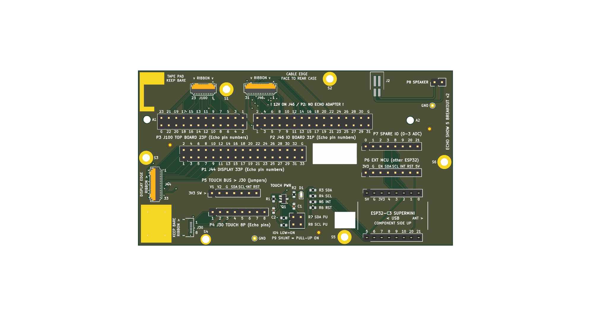

# Echo Show 5 breakout board (v2, drop-in)

A test board **the size and shape of the Echo's mainboard** (KC19-TI MLB, 108 × 60 mm). It screws into
the rear case in the mainboard's place, so every original ribbon plugs straight in. It's for mapping and
testing the Echo Show 5 (2nd gen, "cronos") parts before the CM4 carrier board is designed. See
[ECHO-SHOW-5.md](../ECHO-SHOW-5.md) for the hardware findings it serves.



## Why it's mainboard-shaped

The ribbons are short:

| Ribbon | Length | Note |
|---|---|---|
| Display (J44) | 17.5 mm | Tight |
| Touch (J30) | About 17.5 mm | Tight |
| Top board (J100) | 23 mm | |
| IO board (J46) | 44 mm | |

None of them can reach a board placed beside the Echo. So each socket sits where the original does, with
its ribbon-facing edge at the original's position. To work with the board outside the case, use the
[ribbon extenders](../ribbon-extenders/README.md). The positions were measured from two photos
(±0.3 mm across, ±0.8 mm down; see "Positions from the photos" in ECHO-SHOW-5.md).

## What's on it

| Socket | Part (LCSC) | Position (mm from the top-left corner) | Broken out to |
|---|---|---|---|
| **J44** display | Hirose FH26W-33S-0.3SHW(60) (C424654) | Body edge x = 4.2, centred y = 39.0, lock side left | P1, 2 × 17 |
| **J30** touch | Hirose FH34SRJ-8S-0.5SH(50) (C88372) | Front face x = 15.1, centred y = 53.8, opening left | P4, 1 × 8 |
| **J100** top board | HCTL HC-FPC-03-10-23RLTAG (C3012331), a copy of Hirose's FH26W-23S-0.3SHW | Body edge y = 4.5, centred x = 22.4, lock side up | P3, 2 × 12 |
| **J46** IO board | Hirose FH26W-31S-0.3SHW(60) (C2973806) | Body edge y = 4.4, centred x = 42.0, lock side up | P2, 2 × 16 |
| **J2** speaker | Molex Pico-SPOX 87438-0243 (C240853) | Centred x = 82.0, mating face 0.6 mm from the top edge, as on the mainboard | P8, 1 × 2 (top-right corner) |

How to read the headers:
- **Header pin n = Echo pin n** on every header, using the mainboard's own silkscreen pin 1:
  - J44 and J30: top end. On J30, 8 is at the bottom, nearest screw S4.
  - J100 and J46: right-hand end.
- The 2-row headers (J44, J100, J46) end with an extra GND pin.

**Mounting:**
- Six 2.6 mm plated holes at the original screw positions, assumed M2. The positions were measured
  from ruler photos of the mainboard (see "Measuring the screw holes" below). An M2 screw can sit up to
  0.3 mm off-centre in a 2.6 mm hole, and the screw head still covers it (the Echo's screws have 3.5 mm heads and are 5.1 mm long).
- **Each hole sits in an exposed, grounded copper pad** on both faces, as on the mainboard: 4.8 mm
  across (3.6 mm at S4, where the board edge is close). The screw head bears on the pad, not on
  solder mask, and the screw ties the board's ground to the case post.
- No tracks or vias within 2.6 mm of any hole centre on the outer layers (rule areas `SCREW_H1`–`H6`).
  The head reaches 1.9 mm out, or 2.2 mm with the screw fully off-centre.
- Screw S4 (bottom edge) is only 2.1 mm from the edge.
- **J44, J46 and J100 are Hirose FH26W sockets, the same way round as the mainboard's.** The ribbon
  enters on the lock side, which faces the board edge. Lift the lock, lay the ribbon in with its contacts
  as it sat in the Echo, and press the lock down onto it. The mainboard's J46 carries Hirose's mark on
  its lock and matches the FH26W-31 in size, leg counts (16 at the edge, 15 inboard) and end tabs.
- **J30 is a Hirose FH34SRJ-8S-0.5SH, at the mainboard socket's own position.** The mainboard's
  socket matches that part on every measured point: 6.0 mm wide, 3.8 mm deep, back-flip lock on the leg
  side, 0.3 mm ribbon, and a ribbon with 1.5 mm of bare contact and its insertion line at 1.5 mm.
  - An FH12 (used in earlier versions) doesn't work: it needs the ribbon 4.4 mm deep, and the Echo's
    touch ribbon has a 3 mm tongue of which 1.5 mm goes in.
  - The footprint is built in `gen_board.py` from Hirose's recommended pattern (FH34 catalogue, page 8,
    in `../parts-documentation/`): eight 0.3 × 0.8 mm lands and two 0.4 × 0.8 mm fitting lands.
  - **It's a back-flip socket: the lock lifts on the leg side, away from the ribbon.** Push the ribbon
    in to its white line, then press the lock down.
- **Bare ground pads.** The mainboard grounds to its surroundings through bare gold pads, and the
  breakout has the same ones. Keep them all bare: no tape, no flux residue.
  - **GP1, top, left of J30** (x 1.0–11.5, y 46.0–59.0): the touch ribbon lies across it. Four plated
    holes tie it to the ground pours on every layer.
  - **GP2, top-left corner** (x 0.6–9.0, y 0.6–4.8, with a sliver down the display edge to a second
    patch at y 12.4–14.0): the metal-mesh tape from the button/mic board sticks here.
  - **GB1–GB9, back:** nine pads where the display frame's conductive fabric gaskets press (GB2–GB5,
    GB7–GB9), plus GB1 under the J30 corner, where the GT911's ground pad rests, and GB6 on the
    display edge. No through-hole part sits inside any of them. Positions are in `BACK_PADS` in
    `gen_board.py`.
- **Two 2.5 mm alignment holes**, as on the mainboard, for the case's 1.8–1.9 mm locating pegs: A1 at 3.1, 16.8 (by the original's J45)
  and A2 at 93.4, 17.05 (by the original's part-number print). The mainboard's are about 2.5 mm.

**ESP32 section** (for the touch test, and for buttons, LEDs and ADC readings later):

- **U1A/U1B:** two 1 × 8 female sockets, 15.24 mm (0.6″) apart, for an **ESP32-C3 SuperMini**,
  component side up, with its USB-C pointing **left, into the board**. The case wall is too close to the
  right and bottom edges for a plug.
  - Pin order, both rows starting at the USB end:
    - Top row (U1A): 5V, GND, 3V3, 4, 3, 2, 1, 0.
    - Bottom row (U1B): 5, 6, 7, 8, 9, 10, 20, 21.
  - Pinout drawings of the module's underside show the rows the other way round.
  - Check the row spacing against your module before soldering the sockets.
  - Keep the area left of the module free of tall parts for the USB plug.
- **P6 EXT MCU:** 3V3, GND, the five control pins (IO4, IO5, IO6, IO7, IO10) and 5V. Wire any other
  ESP32 here instead.
- **P7 SPARE:** the remaining SuperMini pins. IO0–IO3 are ADC inputs, for the panel-ID resistor or supply
  checks.
- **Touch power switch:**
  - Q1 (AO3401A P-MOSFET) feeds 3V3 to `T_VDD`. IO4 low turns it on; R1 holds it off while the ESP32
    boots. D1 lights when it's on.
- **P5 TOUCH BUS:** V1, V2, GND, SDA, SCL, INT, RST.
  - V1 and V2 are both `T_VDD` (switched 3.3 V). On the Echo the touch side has two rails (3.0 V `vmch`
    and 3.3 V `vgp1`), so the second pin saves a Y-jumper.
  - The touch I/O voltage is still unknown. If a pin turns out to need 3.0 V, feed it from a bench
    supply instead of P5.
  - SDA, SCL, INT and RST come from IO5, IO6, IO7 and IO10 through 220 Ω series resistors (R3–R6).
  - SDA and SCL have 2.2 kΩ pull-ups (R7, R8) to `T_VDD`, so the pull-ups don't back-power the GT911
    when its supply is off. Each is connected by a shunt on **P9** (2 × 2 header: top row SDA,
    bottom row SCL). Pull a shunt off to remove that pull-up. JLCPCB fits the header, not the
    shunts: use two standard 2.54 mm jumper caps.
  - **Firmware rule:** while `T_VDD` is off (IO4 high), keep IO5, IO6, IO7 and IO10 low or
    high-impedance. Driving one high feeds the GT911 through its 220 Ω resistor.

The touch bus isn't wired to J30 on purpose. J30's signals aren't mapped yet, so once they are, connect
P5 to P4 with jumper wires. A wrong guess costs a wire, not a board.

## Marks on the board

Printed to help assembly and fault-finding:

- **Part names** beside every part and header (R1–R8, C1, C2, Q1, D1, J2, J30, J44, J46, J100,
  P1–P9), with the touch signals named at their resistors (`R3 SDA` … `R6 RST`) and pull-ups.
- **`RIBBON` with an arrow** on the entry side of each ribbon socket, and the end pin numbers (1 and 33,
  31, 23 or 8) at each socket's ends.
- **`! 12V ON J46 / P2: NO ECHO ADAPTER !`** on the front.
- **Which way round:** `CABLE EDGE`, `DISPLAY EDGE`, `FACE TO REAR CASE`, and for the ESP32 module
  `< USB`, `ANT >` and `COMPONENT SIDE UP`, with a line at each end of where the module sits.
- **Holes and pads:** S1–S6, A1, A2, and `KEEP BARE` by the bare ground pads.
- **Two white patches** to write pin functions on while mapping.
- **Back:** `CRONOS BREAKOUT BOARD V2` with `https://github.com/armuk` under it, the board's name, date
  and thickness in the notes, a `1` at pin 1 of every header for probing the solder
  side.
- **Three fiducials** (bare 1 mm dots, FID1–FID3) for the assembly machine.

## Measuring the screw holes

The hole positions come from two straight-down photos of the bare mainboard with a steel rule beside it
(2026-11-16). Each photo was perspective-corrected to the calipered outline (107.96 × 59.91 mm) and the
hole centres read off at full resolution. The two photos agree within 0.2 mm on every hole; the table is
in "Positions from the photos" in ECHO-SHOW-5.md.

To check a hole directly with calipers:

1. Lay the mainboard component side up, with the display edge (J44) on the left and the cable edge (J46,
   J100) at the top.
2. Measure from the left edge to the near side of the hole and to its far side; the average is the
   centre x. Do the same from the top edge for the centre y.
3. If a hole is more than 0.3 mm from the board's position, edit `SCREWS` in `gen_board.py` and rebuild.

## Using it

1. **Fitting:**
   - Take the old mainboard out.
   - Trim the through-hole pins flush on the back and cover **the pins** with Kapton tape. That side
     faces the display frame, as the mainboard's did. Leave the nine bare pads on the back uncovered:
     the frame's conductive gaskets press on them.
   - Stick the button/mic board's mesh tape to the bare pad in the top-left corner (GP2).
   - Screw the breakout in place and plug the ribbons in exactly as they went into the mainboard.
2. **Check pin 1 before trusting the labels.** Beep a pin you can identify (for example a wide ground
   trace) against the old mainboard.
3. **Map by continuity, unpowered.** Beep each header pin against the old mainboard's connector pins or
   test points.
4. **Touch test (the open fault):**
   1. Wire P5 to the J30 pins once they are mapped.
   2. Drive IO4 low to power the touch side, and hold RST low.
   3. Set INT low (0x5d) or high (0x14), then release RST.
   4. Scan I²C for 0x5d and 0x14. If the chip answers, read the product ID at 0x8140 and the sensor ID
      at 0x814A.
   5. **Never write the config registers (0x8047 onward).**
   6. Before switching the touch supply off (IO4 high), set IO5, IO6, IO7 and IO10 low or to inputs.
5. **Power:**
   - Power comes only from the ESP32's USB. The Echo's own 12 V supply comes in through the IO board
     and J46, so **never plug the Echo's adapter in while the breakout is fitted**.
   - J46's 12 V pins would then be live on P2.

## Ordering at JLCPCB

All order files are in [`jlcpcb/`](jlcpcb):

- `echo-breakout-gerbers.zip` (Gerbers and drill files)
- `bom.csv`
- `cpl.csv`

Steps:

1. Upload the zip. Settings:
   - **4 layers** (two layers couldn't fit the fan-out from the 0.3 mm sockets in the mainboard
     outline), **1.0 mm thick** like the mainboard (the ribbons wrap its edge, so a thicker board uses up
     ribbon length), JLC's default 4-layer stackup for that thickness.
   - 108 × 60 mm.
   - ENIG recommended (flatter pads for the 0.3 mm sockets).
   - Mark on PCB: **Remove Mark**. JLCPCB no longer prints the order number at a chosen spot (since May
     2026), so the board carries no `JLCJLCJLCJLC` marker.
2. Turn on **PCB Assembly**, top side, and upload the BOM and CPL.
   - **Edge rails and fiducials: let JLCPCB add them.** Parts sit as close as 0.3 mm to the board edge
     (J2, the ESP32 sockets, P8, the ribbon sockets), so the assembly line needs their 5 mm rails. The
     board's own three fiducials meet their rule (1 mm dot, 2 mm opening, over 3.35 mm from the edge).
   - Boards arrive with the rails attached unless you pay to have them removed. **Snap them off and
     file the break points flush** before fitting: the board has to drop into the mainboard's place.
3. **Check every part's rotation in JLCPCB's placement preview**, above all the four ribbon sockets:
   - Each socket's pin 1 mark must match the board.
   - **J44, J46 and J100 (FH26W):** the dark flip lock, the two metal end tabs and the larger leg row
     must be at the board edge, with the smaller leg row inboard. The ribbon enters on the lock side.
     Earlier versions of this board had them the other way round.
   - **J30 (FH34SRJ):** the opposite: its legs and lock are inboard, and the ribbon enters on the plain
     side facing the display edge.
   - **The placement file already carries JLCPCB's rotations** for the headers, the ESP32 sockets, the
     three FH26W-pattern sockets, Q1 and J2 (`JLC_ROTATION` in `finish_board.py`, read off their preview
     on 2026-11-16). In the preview, each part's magenta pin 1 mark must sit on the pad marked `1`, and
     its legs must lie on the pads.
   - **J30's and J2's footprints are this project's own**, so JLCPCB's rotation for them is the least
     certain. J30's eight legs must be on the right, away from the display edge. J2's two tails must
     point down the board, with its open mouth at the top edge.
4. **Three parts are substitutes**, as the first choices were out of stock at JLCPCB on 2026-11-16:

   | Part | First choice | In the BOM now |
   |---|---|---|
   | J100 | Hirose FH26W-23S-0.3SHW(60) (C3168948) | HCTL (Huacan Tianlu) HC-FPC-03-10-23RLTAG (C3012331) |
   | D1 | Everlight 19-217/GHC-YR1S2/3T (C72043) | NationStar NCD0603G1 (C84267), the same emerald green |
   | P1 | Kinghelm KH-2.54PH180-2X17P-L8.9 (C5157640) | Hong Cheng HC-PZ254-11.5L-2x17PZ (C41376108) |

   - **J100:** the copy's drawing matches the FH26W-23S: same signal lands, same ribbon (0.2 mm thick,
     7.2 mm wide, staggered), bottom contact, ribbon in on the tab side, 1.0 mm high. Only the tab lands
     differ, by 0.2 mm at most. Its flip lock is more fragile than Hirose's.
   - Two more copies with the same drawing: Hongcheng HC-FPC-0.3-23P-FH10 (C49166929) and
     XFCN F0302-B-23-10G-R (C25170829).
   - **P1, P2 and P3 are plain 11.5 mm pin headers**: Hong Cheng for P1 and P3 (P3:
     HC-PZ254-11.5L-2x12PZ, C41375953), HanElectricity 2541WV-2x16P (C25503139) for P2. Their pins
     stand 6 mm above the plastic, like the single-row headers. Two other 2 × 16 headers fit, but
     showed as a blank block in JLCPCB's preview: Hong Cheng HC-PZ254-11.5L-2x16PZ (C41376107) and
     Kinghelm KH-2.54PH180-2X16P-L11.5 (C19630944).
   - **Don't use Kinghelm's KH-2.54PH180-2XnP-L8.9 parts** (C5157640, C5157639, C5157635). They are
     shrouded IDC box headers, not plain pin headers: P2's and P3's bodies would collide.
   - To go back to a first choice, change its number in `gen_board.py` and rebuild.
5. **Through-hole parts are in the BOM too**, so JLCPCB fits the headers and the two ESP32 sockets
   (2.54 mm straight parts, Hong Cheng and Kinghelm):
   - This needs their through-hole assembly, which is priced per joint; there are about 150 joints.
   - Check each header's position and rotation in the placement preview. `cpl.csv` gives the centre of
     each part, which is what JLCPCB expects, but their library part may sit a quarter-turn off.
   - Stock on the less common sizes (2 × 12, 2 × 16, 2 × 17) is sometimes low. If one is short, mark
     it "do not place" and solder it yourself.
   - **The pins stand about 2 mm proud of the back.** Trim them flush before fitting the board in the
     Echo: the back faces the display frame and its conductive gaskets.
6. Left for you: the two GND test loops (TP1, TP2) are bare plated holes; solder in a wire loop or clip
   onto a screw pad instead.

DRC (KiCad 10): 0 unconnected items. No violations. The rules are 0.15 mm tracks and clearance, 0.4 mm power tracks and 0.3/0.6 mm
vias, and silkscreen strokes of at least 0.15 mm, all within JLCPCB's standard limits.

## Rebuilding

The board is generated by script. Run these from this folder; the autorouter is in the repo's
[`tools/`](../../../tools):

```bash
PY=/Applications/KiCad/KiCad.app/Contents/Frameworks/Python.framework/Versions/3.9/bin/python3
$PY gen_board.py          # placement, nets, silkscreen, BOM -> echo-breakout-unrouted.kicad_pcb + .dsn
java -Djava.awt.headless=true -jar ../../../tools/freerouting-2.1.0.jar --gui.enabled=false \
     -de "$PWD/echo-breakout.dsn" -do "$PWD/echo-breakout.ses" -mp 200 -mt 6
# check no net is missing from the session (Freerouting 2.1 can report success and still drop nets):
comm -13 <(grep -o '(net [^ )]*' echo-breakout.ses | sort -u) <(grep -o '(net [^ )]*' echo-breakout.dsn | sort -u)
$PY finish_board.py       # import routes, remove stubs, ground pours -> echo-breakout.kicad_pcb
kicad-cli pcb drc echo-breakout.kicad_pcb
sh make_jlcpcb.sh         # Gerbers, drill, CPL
```

**The committed `echo-breakout.ses` predates P9.** A fresh autoroute isn't needed for it: `finish_board.py`
lays the tracks around P9 itself (`route_pullups`), as it does for the speaker. A new session from
Freerouting works too.

Routing results vary between Freerouting runs. If the `comm` check lists any nets, run it again (a
different `-mt` thread count helps). Freerouting 2.1.0 runs on Java 21; the 2.5.0 macOS CLI build crashed
on this board. Editing the board by hand in KiCad is fine, but rerunning the scripts overwrites it.
