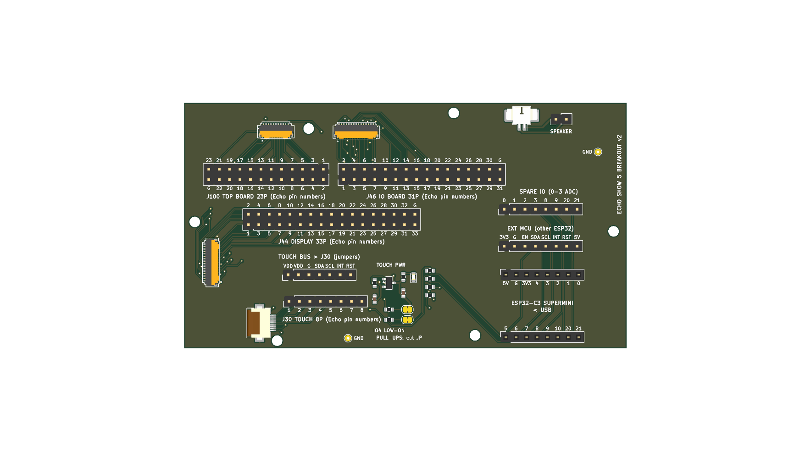

# Echo Show 5 breakout board (v2, drop-in)

A test board **the size and shape of the Echo's mainboard** (KC19-TI MLB, 108 × 60 mm). It screws into
the rear case in the mainboard's place, so every original ribbon plugs straight in. It's for mapping and
testing the Echo Show 5 (2nd gen, "cronos") parts before the P4 board is designed. See
[ECHO-SHOW-5.md](../ECHO-SHOW-5.md) for the hardware findings it serves.



## Why it's mainboard-shaped

The ribbons are short:

| Ribbon | Length | Note |
|---|---|---|
| Display (J44) | 17.5 mm | Tight |
| Touch (J30) | About 17.5 mm | Tight |
| Top board (J100) | 23 mm | |
| IO board (J46) | 44 mm | |

None of them can reach a board placed beside the Echo. So each socket sits where the original does, with
its ribbon-facing edge at the original's position. To work with the board outside the case, use the
[ribbon extenders](../ribbon-extenders/README.md). The positions were measured from two photos
(±0.3 mm across, ±0.8 mm down; see "Positions from the photos" in ECHO-SHOW-5.md).

## What's on it

| Socket | Part (LCSC) | Position (mm from the top-left corner) | Broken out to |
|---|---|---|---|
| **J44** display | Hirose FH26W-33S-0.3SHW(60) (C424654) | Ribbon edge x = 4.2, centred y = 39.0, opening left | P1, 2 × 17 |
| **J30** touch | Hirose FH12-8S-0.5SH(55) (C597995) | Ribbon edge x = 14.9, centred y = 53.8, opening left | P4, 1 × 8 |
| **J100** top board | Hirose FH26W-23S-0.3SHW(60) (C3168948) | Ribbon edge y = 4.4, centred x = 22.4, opening up | P3, 2 × 12 |
| **J46** IO board | Hirose FH26W-31S-0.3SHW(60) (C2973806) | Ribbon edge y = 4.5, centred x = 42.0, opening up | P2, 2 × 16 |
| **J2** speaker | Molex PicoBlade 53261-0271 (C177225) | Top edge at x = 82.4, as on the mainboard | P8, 1 × 2 |

How to read the headers:
- **Header pin n = Echo pin n** on every header, using the mainboard's own silkscreen pin 1:
  - J44 and J30: top end. On J30, 8 is at the bottom, nearest screw S4.
  - J100 and J46: right-hand end.
- The 2-row headers (J44, J100, J46) end with an extra GND pin.

**Mounting:**
- Six plain 2.6 mm holes at the original screw positions, assumed M2. They're larger than an M2
  clearance hole (2.2 mm) to absorb the photo error; an M2 pan head (3.8 mm) still covers them.
- **Measure before ordering** (see below): the positions come from photos.
- Screw S4 (bottom, beside J30) is only 1.9 mm from the edge. Its head clears J30's pins by about
  0.5 mm, so leave that screw out if it touches.

**ESP32 section** (for the touch test, and for buttons, LEDs and ADC readings later):

- **U1A/U1B:** two 1 × 8 female sockets, 15.24 mm (0.6″) apart, for an **ESP32-C3 SuperMini**,
  component side up, with its USB-C pointing **left, into the board**. The case wall is too close to the
  right and bottom edges for a plug.
  - Pin order, both rows starting at the USB end:
    - Top row (U1A): 5V, GND, 3V3, 4, 3, 2, 1, 0.
    - Bottom row (U1B): 5, 6, 7, 8, 9, 10, 20, 21.
  - Pinout drawings of the module's underside show the rows the other way round.
  - Check the row spacing against your module before soldering the sockets.
  - Keep the area left of the module free of tall parts for the USB plug.
- **P6 EXT MCU:** 3V3, GND, the five control pins (IO4, IO5, IO6, IO7, IO10) and 5V. Wire any other
  ESP32 here instead.
- **P7 SPARE:** the remaining SuperMini pins. IO0–IO3 are ADC inputs, for the panel-ID resistor or supply
  checks.
- **Touch power switch:**
  - Q1 (AO3401A P-MOSFET) feeds 3V3 to `T_VDD`. IO4 low turns it on; R1 holds it off while the ESP32
    boots. D1 lights when it's on.
- **P5 TOUCH BUS:** VDD, VDD, GND, SDA, SCL, INT, RST.
  - Both VDD pins are `T_VDD` (switched 3.3 V). On the Echo the touch side has two rails (3.0 V `vmch`
    and 3.3 V `vgp1`), so the second pin saves a Y-jumper.
  - The touch I/O voltage is still unknown. If a pin turns out to need 3.0 V, feed it from a bench
    supply instead of P5.
  - SDA, SCL, INT and RST come from IO5, IO6, IO7 and IO10 through 220 Ω series resistors (R3–R6).
  - SDA and SCL have 2.2 kΩ pull-ups (R7, R8) to `T_VDD`, so the pull-ups don't back-power the GT911
    when its supply is off. To remove them, cut solder jumpers JP1 and JP2.
  - **Firmware rule:** while `T_VDD` is off (IO4 high), keep IO5, IO6, IO7 and IO10 low or
    high-impedance. Driving one high feeds the GT911 through its 220 Ω resistor.

The touch bus isn't wired to J30 on purpose. J30's signals aren't mapped yet, so once they are, connect
P5 to P4 with jumper wires. A wrong guess costs a wire, not a board.

## Measuring the screw holes

Do this on the old mainboard before ordering, and write the results into "Positions from the photos" in
ECHO-SHOW-5.md.

1. Lay the mainboard component side up, with the display edge (J44) on the left and the cable edge (J46,
   J100) at the top, as in the photos.
2. For each screw hole, use the caliper's depth rod or outside jaws to measure:
   - the left edge to the near side of the hole, and the left edge to the far side; the average is the
     centre x;
   - the top edge to the near and far sides in the same way, for the centre y.
3. Measure the hole's diameter with the inside jaws.
4. Measure the board's width and height too. If the board isn't exactly 108 × 60 mm, scale the
   positions to match.

If every hole is within 0.4 mm of the board's position (the slack the 2.6 mm holes give an M2 screw), the
board is fine as it is. If any is further out, edit `SCREWS` in `gen_board.py` and rebuild.

## Using it

1. **Fitting:**
   - Take the old mainboard out.
   - Trim the through-hole pins flush on the back and cover the back with Kapton tape. That side faces
     the screen's metal back, as the mainboard's did.
   - Screw the breakout in place and plug the ribbons in exactly as they went into the mainboard.
2. **Check pin 1 before trusting the labels.** Beep a pin you can identify (for example a wide ground
   trace) against the old mainboard.
3. **Map by continuity, unpowered.** Beep each header pin against the old mainboard's connector pins or
   test points.
4. **Touch test (the open fault):**
   1. Wire P5 to the J30 pins once they are mapped.
   2. Drive IO4 low to power the touch side, and hold RST low.
   3. Set INT low (0x5d) or high (0x14), then release RST.
   4. Scan I²C for 0x5d and 0x14. If the chip answers, read the product ID at 0x8140 and the sensor ID
      at 0x814A.
   5. **Never write the config registers (0x8047 onward).**
   6. Before switching the touch supply off (IO4 high), set IO5, IO6, IO7 and IO10 low or to inputs.
5. **Power:**
   - Power comes only from the ESP32's USB. The Echo's own 12 V supply comes in through the IO board
     and J46, so **never plug the Echo's adapter in while the breakout is fitted**.
   - J46's 12 V pins would then be live on P2.

## Ordering at JLCPCB

All order files are in [`jlcpcb/`](jlcpcb):

- `echo-breakout-gerbers.zip` (Gerbers and drill files)
- `bom.csv`
- `cpl.csv`

Steps:

1. Upload the zip. Settings:
   - **4 layers** (two layers couldn't fit the fan-out from the 0.3 mm sockets in the mainboard
     outline), 1.6 mm, JLC's default 4-layer stackup.
   - 108 × 60 mm.
   - ENIG recommended (flatter pads for the 0.3 mm sockets).
2. Turn on **PCB Assembly**, top side, and upload the BOM and CPL.
3. **Check every part's rotation in JLCPCB's placement preview**, above all the four ribbon sockets:
   - Each socket's pin 1 mark must match the board.
   - The opening must face the board edge: left for J44 and J30, up for J100 and J46.
4. **J100 (C3168948) was out of stock at LCSC on 2026-11-15.** Either:
   - pre-order it through JLC's global sourcing, or
   - mark J100 "do not place" and fit it yourself. It's a 0.3 mm part, but each of its two rows is 0.6 mm
     pitch: use flux and drag soldering, or hot air.
5. Solder the through-hole parts yourself; they're not in the BOM:
   - pin headers: 2 × 17, 2 × 16, 2 × 12, 3 × 1 × 8, 1 × 7, 1 × 2
   - two 1 × 8 female sockets
   - two GND test loops

DRC (KiCad 10): 0 unconnected items. One accepted exception: screw hole H4 sits inside J30's courtyard
(see Mounting above). The rules are 0.15 mm tracks and clearance, 0.4 mm power tracks and 0.3/0.6 mm
vias, and silkscreen strokes of at least 0.15 mm, all within JLCPCB's standard limits.

## Rebuilding

The board is generated by script:

```bash
PY=/Applications/KiCad/KiCad.app/Contents/Frameworks/Python.framework/Versions/3.9/bin/python3
$PY gen_board.py          # placement, nets, silkscreen, BOM -> echo-breakout-unrouted.kicad_pcb + .dsn
java -Djava.awt.headless=true -jar freerouting-2.1.0.jar --gui.enabled=false \
     -de "$PWD/echo-breakout.dsn" -do "$PWD/echo-breakout.ses" -mp 200 -mt 6
# check no net is missing from the session (Freerouting 2.1 can report success and still drop nets):
comm -13 <(grep -o '(net [^ )]*' echo-breakout.ses | sort -u) <(grep -o '(net [^ )]*' echo-breakout.dsn | sort -u)
$PY finish_board.py       # import routes, remove stubs, ground pours -> echo-breakout.kicad_pcb
kicad-cli pcb drc echo-breakout.kicad_pcb
sh make_jlcpcb.sh         # Gerbers, drill, CPL
```

Routing results vary between Freerouting runs. If the `comm` check lists any nets, run it again (a
different `-mt` thread count helps). Freerouting 2.1.0 runs on Java 21; the 2.5.0 macOS CLI build crashed
on this board. Editing the board by hand in KiCad is fine, but rerunning the scripts overwrites it.
